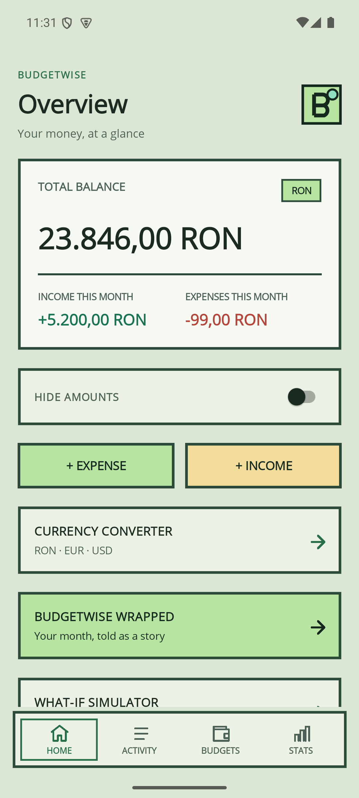
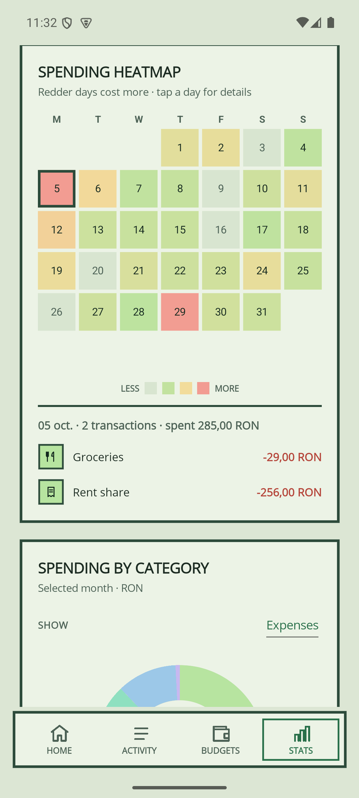
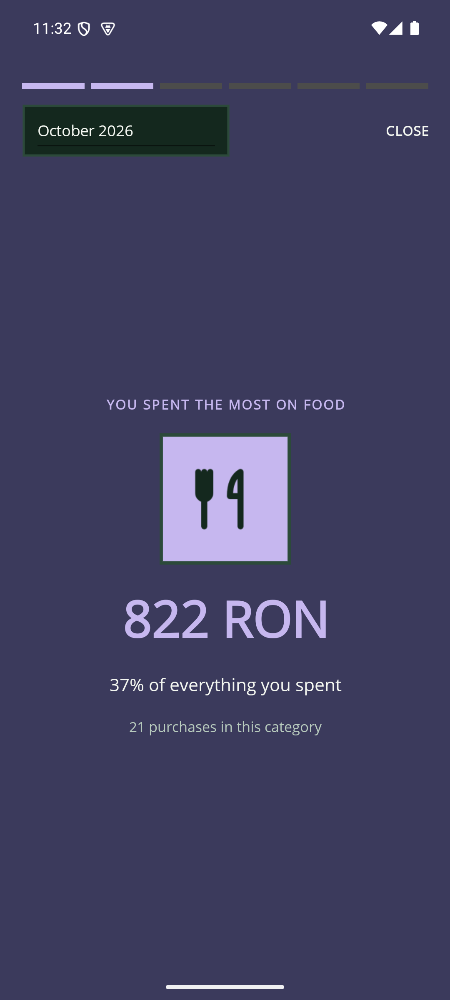
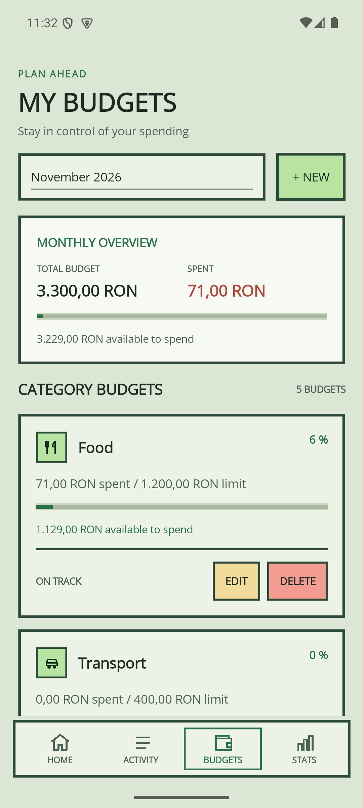
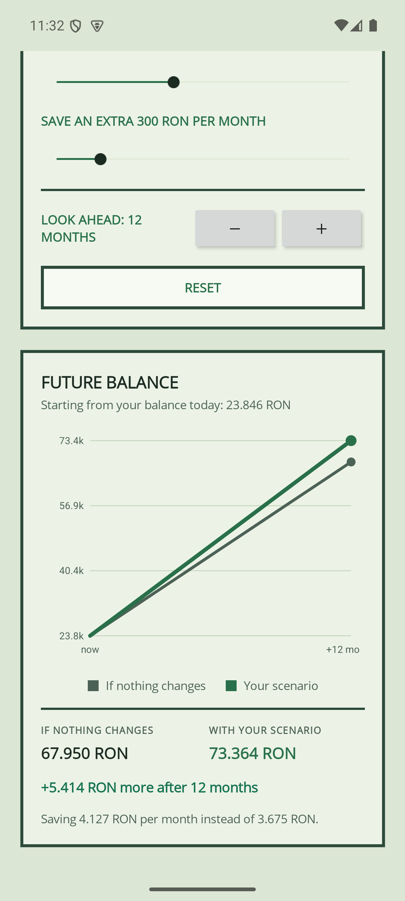
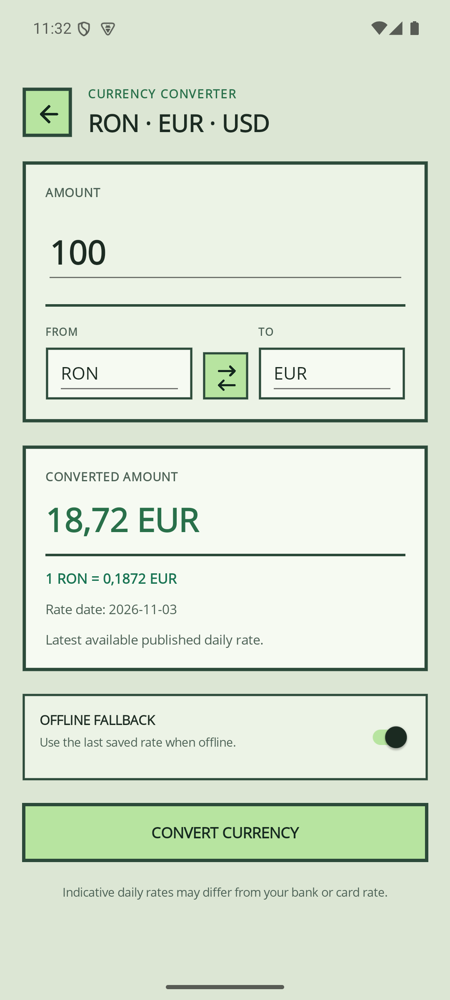

<h1 align="center">BudgetWise</h1>

<p align="center">
  A cross-platform personal budget tracker built with <b>.NET MAUI</b>, <b>XAML</b> and <b>.NET 10</b>.<br/>
  Track spending, set monthly budgets, explore your habits and test savings plans.
</p>

<p align="center">
  
  
  
  
</p>

---

## Screenshots

| Home | Spending heatmap | Wrapped |
| :---: | :---: | :---: |
|  |  |  |

| Budgets | What-if simulator | Currency converter |
| :---: | :---: | :---: |
|  |  |  |

## Features

**Everyday tracking**
- Add, edit and delete income and expense transactions with amount, category, date and description.
- Search by text and filter by type.
- Nine built-in categories (six for expenses, three for income), each with its own icon.
- Hide all amounts with one switch, handy when someone is looking over your shoulder.

**Budgets**
- Monthly limit per category with a progress bar, the amount left and a clear warning when you go over.

**Insights**
- **Monthly summary:** income, expenses and net balance.
- **Category chart:** a donut chart for expenses or income.
- **Six-month trend:** income versus expenses.
- **Spending heatmap:** a calendar where every day is shaded by how much you spent. Tap a day to see its transactions.

**Going further**
- **What-if simulator:** start from your average month, cut spending in a category or save a bit extra, and see your future balance with and without the plan.
- **BudgetWise Wrapped:** your month as an animated story: top category, priciest day, savings rate, comparison with the previous month and a final summary.
- **Currency converter:** RON, EUR and USD with live exchange rates and an offline fallback to the last saved rate.

> New here? Open the app and tap **Load demo data** on the Home screen to fill it with six months of sample transactions.

## Built with

| Area | Technology |
| --- | --- |
| Framework | .NET MAUI on .NET 10 |
| UI | XAML pages, Shell navigation, a custom bottom navigation control |
| Storage | SQLite through [sqlite-net-pcl](https://github.com/praeclarum/sqlite-net): three tables (`Category`, `Transaction`, `Budget`) |
| Networking | `HttpClient` and `System.Text.Json` against the [Frankfurter](https://frankfurter.dev) exchange-rate API |
| Charts | Custom drawing with `GraphicsView` and `IDrawable`: donut, bars, heatmap and projection line |
| Images | SVG resources converted by MAUI for each platform |
| Settings | MAUI `Preferences` (hidden amounts, last exchange rate) |

## Getting started

**Prerequisites**
- [.NET 10 SDK](https://dotnet.microsoft.com/download) with the MAUI workload: `dotnet workload install maui`
- Windows: nothing else (Windows 10 or 11)
- Android: JDK 17 or newer, the Android SDK and an emulator or a phone with USB debugging
- iOS and macOS: a Mac with Xcode

**Run it**

```bash
git clone https://github.com/vasiletarcuta/BudgetWise.git
cd BudgetWise

# Windows
dotnet run -f net10.0-windows10.0.19041.0

# Android (emulator running or phone connected)
dotnet build -t:Run -f net10.0-android
```

The database is created on first launch. All your data stays on your device; the only network call is the exchange-rate lookup in the currency converter.

## Platform status

| Platform | Status |
| --- | --- |
| Android | Built and tested |
| Windows 10 / 11 | Built and tested |
| iOS | Target configured, not built or tested yet |
| macOS (Mac Catalyst) | Target configured, not built or tested yet |

## Project structure

```text
BudgetWise/
├── Models/        Category, Transaction, Budget (the SQLite tables)
├── Services/      DatabaseService, CurrencyService, CategoryIcons, Palette
├── Views/         The nine pages (XAML + code-behind)
├── Controls/      Custom bottom navigation bar
├── Graphics/      Chart drawing: donut, bars, heatmap, projection
├── Resources/     SVG images, app icon, splash screen, fonts, Palette.xaml
├── Platforms/     Android, iOS, Mac Catalyst and Windows specifics
├── MauiProgram.cs Services and app setup
└── AppShell.xaml  Navigation
```

## Theme

All colours live in one place, `Resources/Styles/Palette.xaml`, and `Services/Palette.cs` exposes them to code. Change a value there and every page and chart follows.

## Ideas for later

- Recurring transactions
- Exporting data
- A Romanian translation of the interface
- Testing and releasing on iOS and macOS

## Team

- Bianca-Maria Bululete – [@biancabululete](https://github.com/biancabululete)
- Vasile Tărcuță – [@vasiletarcuta](https://github.com/vasiletarcuta)

Built as a university project.

## Acknowledgements

- Exchange rates by [Frankfurter](https://frankfurter.dev)
- [.NET MAUI](https://learn.microsoft.com/dotnet/maui/) and [sqlite-net](https://github.com/praeclarum/sqlite-net)
